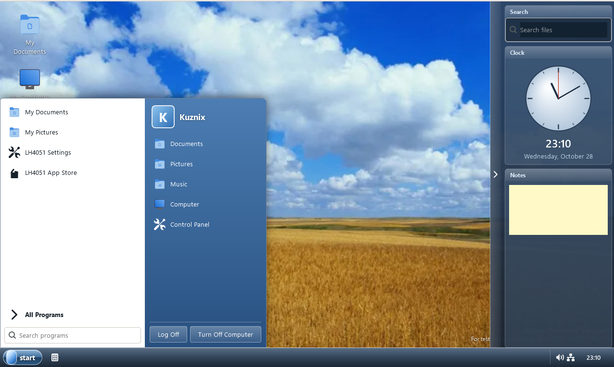

# LH4051-DE



A GTK4 desktop shell that recreates the look of **Windows "Longhorn" Build 4051** (PDC 2003):
slate taskbar with a pill-shaped Start button, translucent sidebar (search, analog clock, notes),
two-column Start menu, Longhorn-framed windows, and an Explorer with the blue "Phode" header.

**Version 0.1.1 — stable release, 0.1.x LTS line (`stable` branch).** This branch only receives bug fixes and small
features. New development happens on [`main`](https://github.com/kuznix-code/LH4051-DE/tree/main) (0.2.0.dev).
See [docs/BRANCHING.md](docs/BRANCHING.md) for how branches and releases work.

| Branch | Purpose |
|--------|---------|
| `main` | 0.2.0.dev — new features and everything in progress |
| `stable` | 0.1.x LTS — bug fixes and minor features only (this branch) |
| `beta` | 0.2.0 betas, created from `main` when needed |

Runs on **Linux** (x86, x64, ARM64), **Windows 7, 8, 8.1, 10 and 11** (x64, ARM64; MinGW-w64 or MSVC), **macOS** (Intel and Apple Silicon),
and **FreeBSD / OpenBSD / NetBSD / DragonFly** or any other unix-like system with GTK 4.10+ (ELF, Mach-O and PE targets).

## Install
Every release ships a **LH4051-DE Installer**:

| OS | Installer |
|----|-----------|
| Windows x64 / ARM64 | `LH4051-DE-Installer-<ver>-win-<arch>.exe` (Inno Setup wizard; GTK runtime included) |
| macOS Intel / ARM | `LH4051-DE-Installer-<ver>-macos-<arch>.pkg` (installs `LH4051-DE.app`; needs `brew install gtk4`) |
| Linux, BSD, other unix | `sh LH4051-DE-Installer-<ver>-<os>-<arch>.run [--prefix DIR] [--yes] [--uninstall]` |
| Arch Linux | `make dist-arch` (PKGBUILD for the tagged release) |

Windows x86 is not supported: MSYS2 has no 32-bit GTK 4.

### Updating: LH4051-DE Updater
`lh4051-de-updater` downloads and runs the right installer for your OS, or builds from source if there is none.
It finds an existing installation itself (version file, macOS app bundle, uninstall entry on Windows) and only installs
when something newer is available (`--force` / `-Force` overrides).

| Mode | What it installs |
|------|------------------|
| `stable` (default) | newest stable release |
| `beta` | newest beta (GitHub prerelease) |
| `lts` / `lts-0.1` | newest release of the newest LTS line / of one LTS line |
| `0.1.1`, `lts-0.1.1` | one exact release, **supported releases only** (see [docs/supported-releases.txt](docs/supported-releases.txt)) |
| `dev`, `stable-dev`, `beta-dev`, `lts-dev`, `0.1-dev` | latest successful CI build of `main`, `stable`, `beta`, `lts`, or of the branch carrying line 0.1, versioned `<version>.YYYYMMDD.<commit>` |

CI builds are GitHub Actions artifacts, which need a GitHub token (`gh auth login` or `GH_TOKEN`). Without one the unix
updater builds that branch from source; on Windows set `GH_TOKEN`. Releases (`stable`, `beta`, `lts`, versions) need no token.

* **Windows**: `lh4051-de-updater.cmd -Mode beta` (`-Check`, `-Yes`, `-Force`) runs the `.exe` installer.
* **macOS**: runs the `.pkg` installer (`LH4051-DE.app/Contents/Resources/lh4051-de-updater`).
* **Linux, FreeBSD**: `lh4051-de-updater [--mode beta] [--check] [--yes] [--force] [--prefix DIR]` runs the `.run` installer.
* **Any other OS or architecture** (or `--source`): downloads the source and compiles it. This needs GTK 4.10+
  development files, a C compiler, GNU Make (`gmake` on BSD) and pkg-config.

The mode can also be set with `LH4051_UPDATE_MODE` or `mode=beta` in `~/.config/lh4051-de/updater.conf`.

### Windows 7, 8 and 8.1
The executable declares Windows 7/8/8.1 compatibility and the installer accepts Windows 7 SP1 and newer.
`make win64-legacy` builds with the Windows 7 API level (`WIN_MIN=0x0601`), and `scripts/check-win7.sh` lists any
imports in the exe or bundled GTK runtime that need a newer Windows. Windows 7 also needs the
[Universal C Runtime update (KB2999226)](https://support.microsoft.com/kb/2999226) and PowerShell 3.0+ (WMF 5.1) for the updater.
winget is not available on these systems; the App Store uses Chocolatey or Scoop there.

## How it runs

| Mode | When | What happens |
|------|------|--------------|
| **layer-shell** | Wayland compositor with `wlr-layer-shell` + `gtk4-layer-shell` installed | desktop, taskbar, sidebar and Start menu are real shell surfaces; the taskbar reserves screen space |
| **composite** | everything else (Windows, X11, GNOME/KDE Wayland, macOS) | the whole shell is drawn in one full-screen window; app windows open on top |

`lh4051-de --windowed` runs composite mode in a normal 1280x800 window (good for trying it out).
`LH4051_MODE=composite` forces composite mode on Wayland.

## Build

### Linux
```sh
# Debian/Ubuntu
sudo apt install build-essential pkg-config libgtk-4-dev libglib2.0-dev-bin libgtk4-layer-shell-dev
# Fedora: gtk4-devel gtk4-layer-shell-devel   Arch: gtk4 gtk4-layer-shell
make -j$(nproc)
make run ARGS=--windowed
sudo make install            # PREFIX=/usr/local by default; DESTDIR supported
make dist-linux              # dist/lh4051-de-<ver>-linux-<arch>.tar.gz
```
`gtk4-layer-shell` is optional; without it the shell uses composite mode.

### macOS (Intel and Apple Silicon)
```sh
brew install gtk4 pkgconf
make macos                   # build/macos-clang/lh4051-de
make installer-macos         # dist/LH4051-DE.app, .zip and "LH4051-DE Installer" .pkg
```
macOS runs the shell in a window (`--windowed`); the app list also shows `.app` bundles.

### FreeBSD / OpenBSD / NetBSD / other unix
GNU make is required (`gmake` on BSD):
```sh
pkg install gmake gtk4 pkgconf        # FreeBSD    (OpenBSD: pkg_add gmake gtk4; NetBSD: pkgin install gmake gtk4)
gmake && gmake install                # or: gmake installer-unix
```
Any other unix-like OS works the same way when GTK4 is installed (`TARGET_OS` is detected from `uname -s`).

### Windows — MinGW-w64 (MSYS2)
MSYS2 has phased out the plain MINGW64 environment; use **UCRT64** (x64), **CLANG64**, or **CLANGARM64** (ARM64).
In an **MSYS2 UCRT64** shell:
```sh
pacman -S make zip mingw-w64-ucrt-x86_64-toolchain mingw-w64-ucrt-x86_64-pkgconf \
          mingw-w64-ucrt-x86_64-gtk4 mingw-w64-ucrt-x86_64-adwaita-icon-theme
make win64                   # build/windows-mingw/lh4051-de.exe
make dist-win64              # dist/lh4051-de-<ver>-win-x64.zip with the GTK runtime bundled
```
In CLANG64/CLANGARM64 there is no gcc: use `make win64 CC=clang` (set `WIN_ARCH=arm64` to name the bundle).
Cross-compiling from Linux works too if a MinGW GTK4 sysroot exists (`MINGW_PREFIX=/usr/x86_64-w64-mingw32`,
or an MXE/Fedora `x86_64-w64-mingw32-pkg-config`): `make win64`.

### Windows — MSVC
From an **x64 Native Tools Command Prompt** with GNU make, pkgconf/pkg-config and a
[gvsbuild](https://github.com/wingtk/gvsbuild) GTK4 tree:
```bat
make msvc GTK_PREFIX=C:/gtk GLIB_COMPILE_RESOURCES=C:/gtk/bin/glib-compile-resources.exe
```
Make sure MSVC's `link.exe` comes before MSYS2's coreutils `link` in `PATH`.
At runtime put `C:\gtk\bin` next to the exe or on `PATH`.

### Useful variables
`DEBUG=1` · `LTO=1` · `MARCH=x86-64-v3` · `CONSOLE=1` (Windows console for logs) ·
`LAYER_SHELL=auto|1|0` · `CC=clang` · `BUILD=<dir>` · `make show-config` prints the resolved setup.
(The old `ARCH=`/`TARGET=` interface and the 200 hard-coded toolchain targets are gone; use `CC`, `MARCH`, `TRIPLE`.)

## Using it
* **Start** opens the menu: pinned places, *All Programs* (searchable), user block, Log Off / Turn Off (closes the shell).
* **Taskbar** buttons track open windows; click to focus or minimize.
* **Sidebar**: Search (opens Explorer filtered by your text), Clock, Notes (autosaved). Use the edge handle to collapse.
* **Explorer**: back/forward/up, path bar, live filter, sortable columns, hidden-file toggle, favorite links.
* **Settings**: desktop icons, watermark, wallpaper, 24-hour clock, sidebar. Stored in `~/.config/lh4051-de/settings.ini`
  (`%APPDATA%\lh4051-de` on Windows).
* **App Store**: installed apps plus search/install/remove through the package manager you pick in the drop-down.
  Detected automatically: Windows `winget`, Chocolatey, Scoop; macOS Homebrew, MacPorts; FreeBSD `pkg`, OpenBSD `pkg_add`,
  NetBSD `pkgin`; Linux PackageKit (`pkcon`), apt, dnf, pacman, zypper, apk, xbps, emerge, nix, Snap, Flatpak and AppStream.
  Search works for every one of them; on Linux PackageKit is tried first and the native package manager is used when
  PackageKit is missing or finds nothing. Privileged commands go
  through pkexec/doas/sudo and show a live log.

On Windows the shell covers the screen. Press **Alt+F4** on the shell, or use *Start → Turn Off Computer*, to exit;
`--windowed` avoids this.

## Sessions (Linux login managers)
`make install` installs `lh4051-de-session` and Wayland/X11 session entries. The Wayland session starts
`labwc` (or `sway`) with the shell as its autostart; set `LH4051_COMPOSITOR` to use another layer-shell compositor.

The project does not bundle Microsoft artwork; the wallpaper is an included image and can be replaced in Settings.
